<!-- Improved compatibility of back to top link: See: https://github.com/othneildrew/Best-README-Template/pull/73 -->

<!--  *** Thanks for checking out the Best-README-Template. If you have a suggestion that would make this better, please fork the repo and create a pull request or simply open an issue with the tag "enhancement". Don't forget to give the project a star! Thanks again! Now go create something AMAZING! :D -->

<!-- /// d   u   b   p   i   x   e   l  ---  f   o   r   k   ////--v0.5.7 -->
<!--this has additionally been modifed by @dubpixel for hardware use -->
<!--search dpx_tr_again.. search & replace is COMMAND OPTION F -->

<!--this is the version for software -->

<!-- PROJECT SHIELDS -->
<!-- *** I'm using markdown "reference style" links for readability. Reference links are enclosed in brackets [ ] instead of parentheses ( ). See the bottom of this document for the declaration of the reference variables for contributors-url, forks-url, etc. This is an optional, concise syntax you may use. https://www.markdownguide.org/basic-syntax/#reference-style-links -->

[![Contributors][contributors-shield]][contributors-url]
[![Forks][forks-shield]][forks-url]
[![Stargazers][stars-shield]][stars-url]
[![Issues][issues-shield]][issues-url]
[![License][license-shield]][license-url]
[![LinkedIn][linkedin-shield]][linkedin-url]

<!-- PROJECT LOGO -->

  
<h1 align="center">dpx_tr_again</h1>
<h3 align="center"><i>run as many copies of Tessera Remote as you want on macOS</i></h3>
  

    A tiny macOS launcher that opens a <i>new</i> instance of the highest-versioned Tessera Remote installed, so you can run multiple copies side by side.
     
     »  
     <a href="https://github.com/dubpixel/dpx_tr_again"><strong>Project Here!</strong></a>
     »  
      
    <a href="https://github.com/dubpixel/dpx_tr_again/issues/new?labels=bug&template=bug-report---.md">Report Bug</a>
    ·
    <a href="https://github.com/dubpixel/dpx_tr_again/issues/new?labels=enhancement&template=feature-request---.md">Request Feature</a>
    

    
<!-- TABLE OF CONTENTS -->

  
<h3>Table of Contents</h3>

<ol>
    <li>
      <a href="#about-the-project">About The Project</a>
      <ul>
        <li><a href="#built-with">Built With</a></li>
      </ul>
    </li>
    <li>
      <a href="#getting-started">Getting Started</a>
      <ul>
        <li><a href="#prerequisites">Prerequisites</a></li>
        <li><a href="#installation">Installation</a></li>
      </ul>
    </li>
    <li><a href="#usage">Usage</a></li>    
    <li><a href="#roadmap">Roadmap</a></li>
    <li><a href="#contributing">Contributing</a></li>
    <li><a href="#license">License</a></li>
    <li><a href="#contact">Contact</a></li>
    <li><a href="#acknowledgments">Acknowledgments</a></li>
</ol>

<!-- ABOUT THE PROJECT -->

<h3>About The Project</h3>

**What it does.** `TesseraRemoteAgain.app` looks in `/Applications` for every `Tessera Remote*.app`, picks the highest version (a real version sort, so 3.10.0 beats 3.5.2), and launches it with `open -n`. If no copy is installed it shows an alert instead of failing silently.

**Why.** [Tessera Remote](https://www.bromptontech.com/) (Brompton Technology's LED processor control app) is often needed more than once at the same time, for example to talk to several processors or systems at once. macOS normally refuses to start a second copy of an app that is already running. `open -n` forces a fresh instance, and this launcher wraps that in a double-clickable app that always targets the newest installed version, so it keeps working after you upgrade Tessera Remote and you never edit a path by hand.

*Unofficial; not affiliated with or endorsed by Brompton Technology. "Tessera" is their trademark.*

**Keywords:** run multiple instances of Tessera Remote on macOS, open second copy of Tessera Remote, Brompton Tessera multi-instance launcher, Mac open -n, LED processor control.
 

*author(s): // www.dubpixel.tv  - i@dubpixel.tv | other authors* 
 
<h3>Images</h3>

### FRONT
![FRONT][product-front]

(<a href="#readme-top">back to top</a>)

### Built With 

 * POSIX `sh` (no dependencies, no build step)
 * macOS `open -n` and `osascript`
 * `sort -V` for version ordering
 * GitHub Pages (Jekyll) for the project site

<!--
 * [![KiCad][KiCad.org]][KiCad-url]
 * [![Fusion360][Fusion-360]][Autodesk-url]
 * [![FastLed][FastLed.io]][FastLed-url]
 * [![Fusion360][Fusion-360]][Autodesk-url]
 * [![Next][Next.js]][Next-url]
 * [![React][React.js]][React-url]
 * [![Vue][Vue.js]][Vue-url]
 * [![Angular][Angular.io]][Angular-url]
 * [![Svelte][Svelte.dev]][Svelte-url]
 * [![Laravel][Laravel.com]][Laravel-url]
 * [![Bootstrap][Bootstrap.com]][Bootstrap-url]
 * [![JQuery][JQuery.com]][JQuery-url]
 
-->

(<a href="#readme-top">back to top</a>)

<!-- GETTING STARTED -->

## Getting Started

  ### Prerequisites
  * macOS
  * At least one `Tessera Remote*.app` in `/Applications`

  ### Installation

  1. Download `src/TesseraRemoteAgain.zip` and unzip it
  2. Drag `TesseraRemoteAgain.app` wherever you want it (Dock, Desktop, Stream Deck)

(<a href="#readme-top">back to top</a>)

<!-- USAGE EXAMPLES -->
## Usage

Double-click `TesseraRemoteAgain.app`. Each launch opens another independent copy of the newest installed Tessera Remote. Launch it again for as many copies as you need.

Install a newer Tessera Remote and the launcher picks it up automatically.

  <!-- ROADMAP -->
## Roadmap

- [x] Open a new instance of Tessera Remote (`open -n`)
- [x] Always pick the highest installed version (v0.1.1)
- [x] Alert when Tessera Remote is not installed (v0.1.1)
- [x] Project site on GitHub Pages (v0.2.0)

See the [open issues](https://github.com/dubpixel/dpx_tr_again/issues) for a full list of proposed features (and known issues).

<!-- CONTRIBUTING -->
## Contributing

_Contributions are what make the open source community such an amazing place to learn, inspire, and create. Any contributions you make are **greatly appreciated**._

If you have a suggestion that would make this better, please fork the repo and create a pull request. You can also simply open an issue with the tag "enhancement".
Don't forget to give the project a star! Thanks again!

1. Fork the Project
2. Create your Feature Branch (`git checkout -b feature/AmazingFeature`)
3. Commit your Changes (`git commit -m 'Add some AmazingFeature'`)
4. Push to the Branch (`git push origin feature/AmazingFeature`)
5. Open a Pull Request

### Top contributors:

<!-- LICENSE -->
## License
Distributed under the MIT License. Commercial use is allowed; keep the copyright notice and attribution. See `LICENSE` for more information.
<!-- CONTACT -->
## Contact

  ### Joshua Fleitell - i@dubpixel.tv

  Project Link: [https://github.com/dubpixel/dpx_tr_again](https://github.com/dubpixel/dpx_tr_again)

<!-- ACKNOWLEDGMENTS -->
## Acknowledgments

<!--
  *  - the best !
-->

(<a href="#readme-top">back to top</a>)

<!-- MARKDOWN LINKS & IMAGES -->
<!-- https://www.markdownguide.org/basic-syntax/#reference-style-links -->
[contributors-shield]: https://img.shields.io/github/contributors/dubpixel/dpx_tr_again.svg?style=flat-square
[contributors-url]: https://github.com/dubpixel/dpx_tr_again/graphs/contributors
[forks-shield]: https://img.shields.io/github/forks/dubpixel/dpx_tr_again.svg?style=flat-square
[forks-url]: https://github.com/dubpixel/dpx_tr_again/network/members
[stars-shield]: https://img.shields.io/github/stars/dubpixel/dpx_tr_again.svg?style=flat-square
[stars-url]: https://github.com/dubpixel/dpx_tr_again/stargazers
[issues-shield]: https://img.shields.io/github/issues/dubpixel/dpx_tr_again.svg?style=flat-square
[issues-url]: https://github.com/dubpixel/dpx_tr_again/issues
[license-shield]: https://img.shields.io/github/license/dubpixel/dpx_tr_again.svg?style=flat-square
[license-url]: https://github.com/dubpixel/dpx_tr_again/blob/main/LICENSE
[linkedin-shield]: https://img.shields.io/badge/-LinkedIn-black.svg?style=flat-square&logo=linkedin&colorB=555
[linkedin-url]: https://linkedin.com/in/jfleitell
[product-front]: images/front.png
[product-rear]: images/rear.png
[product-front-rendering]: images/front_render.png
[product-rear-rendering]: images/rear_render.png
[product-pcbFront]: images/pcb_front.png
[product-pcbRear]: images/pcb_rear.png
[Next.js]: https://img.shields.io/badge/next.js-000000?style=for-the-badge&logo=nextdotjs&logoColor=white
[Next-url]: https://nextjs.org/
[React.js]: https://img.shields.io/badge/React-20232A?style=for-the-badge&logo=react&logoColor=61DAFB
[React-url]: https://reactjs.org/
[Vue.js]: https://img.shields.io/badge/Vue.js-35495E?style=for-the-badge&logo=vuedotjs&logoColor=4FC08D
[Vue-url]: https://vuejs.org/
[Angular.io]: https://img.shields.io/badge/Angular-DD0031?style=for-the-badge&logo=angular&logoColor=white
[Angular-url]: https://angular.io/
[Svelte.dev]: https://img.shields.io/badge/Svelte-4A4A55?style=for-the-badge&logo=svelte&logoColor=FF3E00
[Svelte-url]: https://svelte.dev/
[Laravel.com]: https://img.shields.io/badge/Laravel-FF2D20?style=for-the-badge&logo=laravel&logoColor=white
[Laravel-url]: https://laravel.com
[Bootstrap.com]: https://img.shields.io/badge/Bootstrap-563D7C?style=for-the-badge&logo=bootstrap&logoColor=white
[Bootstrap-url]: https://getbootstrap.com
[JQuery.com]: https://img.shields.io/badge/jQuery-0769AD?style=for-the-badge&logo=jquery&logoColor=white
[JQuery-url]: https://jquery.com 
[KiCad.org]: https://img.shields.io/badge/KiCad-v8.0.6-blue
[KiCad-url]: https://kicad.org 
[Fusion-360]: https://img.shields.io/badge/Fusion360-v4.2.0-green
[Autodesk-url]: https://autodesk.com 
[FastLed.io]: https://img.shields.io/badge/FastLED-v3.9.9-red
[FastLed-url]: https://fastled.io 
